# 活動 Katsudō

**Your PC, your data.** A local-first activity tracker for Windows that combines a ManicTime-style timeline (apps, windows, away time) with WhatPulse-style input stats (every key, click, scroll and byte), in six retro eras. Built for people who type a lot, game a lot, or just want to know where their days go, without anyone else ever knowing.

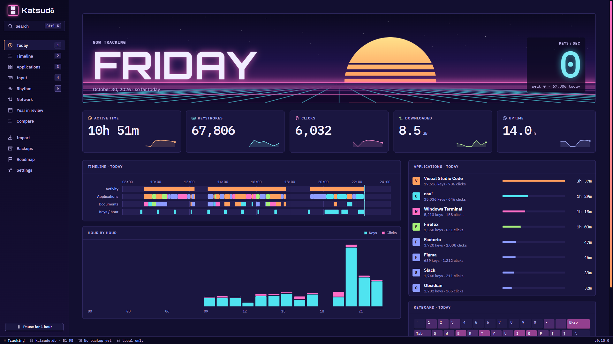

<sub>All screenshots use generated demo data (`scripts/demo-data.py`): a made-up person who codes by day and plays osu! at night.</sub>

## 🔒 Nothing leaves your PC

- **No account, no cloud, no telemetry, no analytics, no update pings.** Katsudō never phones home.
- **Counts, never content.** It records *how many* times each key was pressed, never what you typed or in what order.
- **One file you own:** everything is a single SQLite database in `%APPDATA%\app.katsudo.desktop\katsudo.db`. Copy it, back it up, open it in any SQLite tool, delete it.
- **Verified backups, automatically:** a checked snapshot every day (14 daily and 8 weekly kept), plus safety snapshots before every import and restore. Restore in two clicks.
- **The only time it touches the internet is when you ask it to:** importing your WhatPulse account calls whatpulse.org with the API key you paste in, which is used for that import and never saved. The optional OBS overlay listens on `127.0.0.1` only, refuses requests from any other site, and is only ever sent the keys you choose to show.
- **Open source (MIT).** Read every line that touches your data.

## Leave ManicTime and WhatPulse behind

Katsudō imports your whole history from both, then you can uninstall them:

- **ManicTime:** your entire timeline, apps, documents and sites, straight from its database (read-only, never modified). Millions of segments in under a minute.
- **WhatPulse:** the local database (per-key counts, per-app input, network, uptime, three months of click positions) **and your whole online account**: every computer you ever pulsed from, archived PCs included. Lifetime totals WhatPulse no longer keeps per pulse still count toward your all-time numbers.

Each import shows what it found first, backs up Katsudō, runs in one transaction (cancel leaves nothing behind), and can be re-run safely.

## What's inside

| | |
| --- | --- |
| 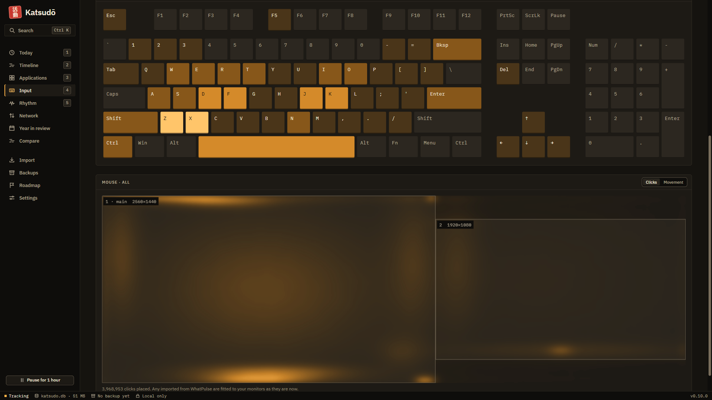 | **Keyboard and mouse heatmaps.** 60%, TKL or full layouts with numpad; instant per-key counts on hover. Where you click and where your pointer travels, drawn over your real monitor layout. |
| 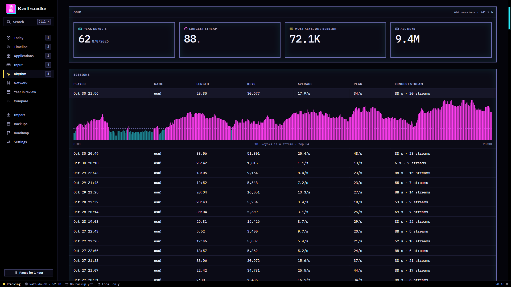 | **Rhythm mode.** Every osu!, Quaver, Etterna, StepMania (and 35+ more) session kept second by second: true peak keys per second, streams of 10+ a second, personal bests per game. The live counter is exact at 1,000 presses a second. |
| 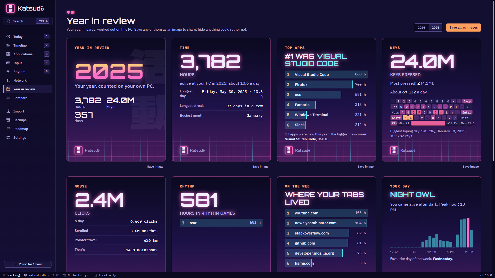 | **Year in review.** A Spotify-Wrapped-style set of cards for any year: hours, top apps and sites, keys, your peak hour, rhythm games, vs last year. Hide anything, save as images. |
| 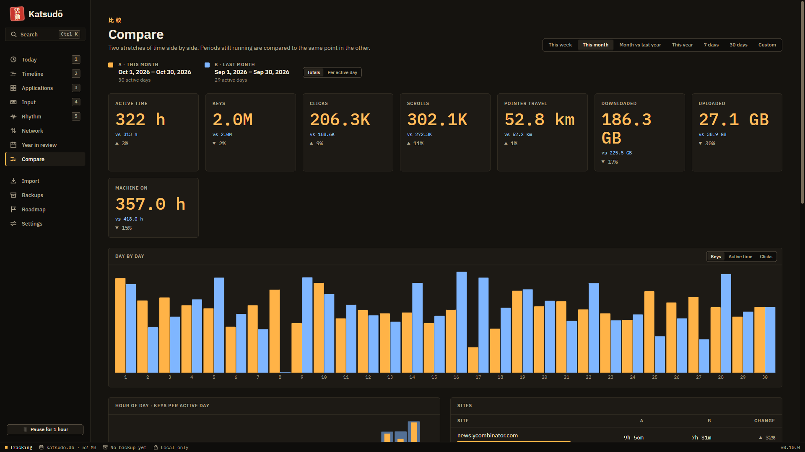 | **Compare periods.** This week vs last, this month vs a year ago, or any two ranges: totals or per day, day by day, hour of day, apps and sites. |
| 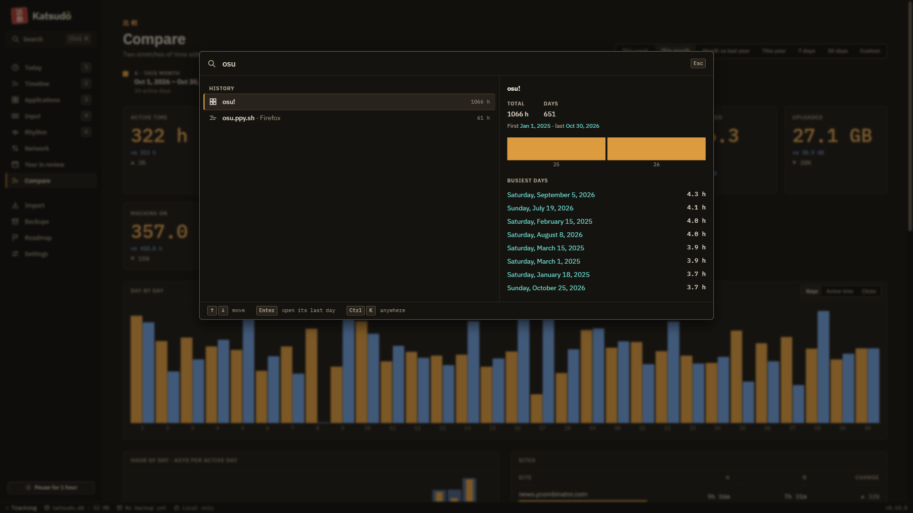 | **Ctrl K everything.** Jump anywhere, switch era, or search every app, window and site in your whole history, with total time, first and last seen and busiest days, in milliseconds. |
| 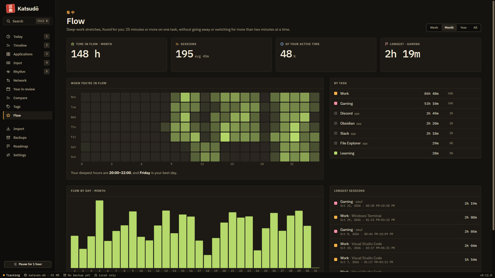 | **Flow and tags.** Deep-work stretches found for you (one task, no long breaks or switching), with your best hours and longest sessions. Tag time by app, window or site with rules that re-tag your whole history in seconds; export to CSV. |
| 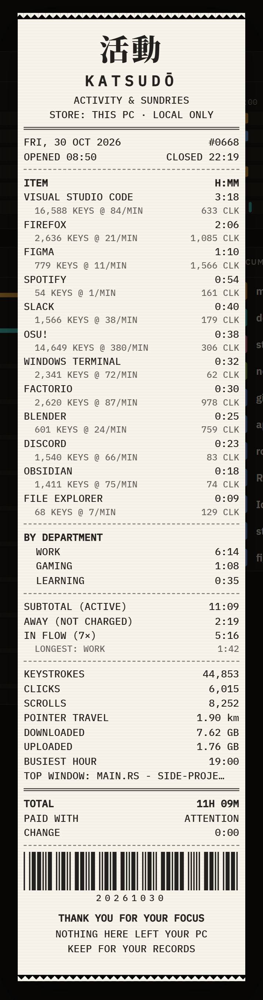 | **Daily receipt.** Any day as a thermal-paper slip: itemised by app with keys per minute, departments from your tags, time in flow, input totals and a barcode that really scans. Print it (80 mm receipt printers too) or save it as an image. |
| 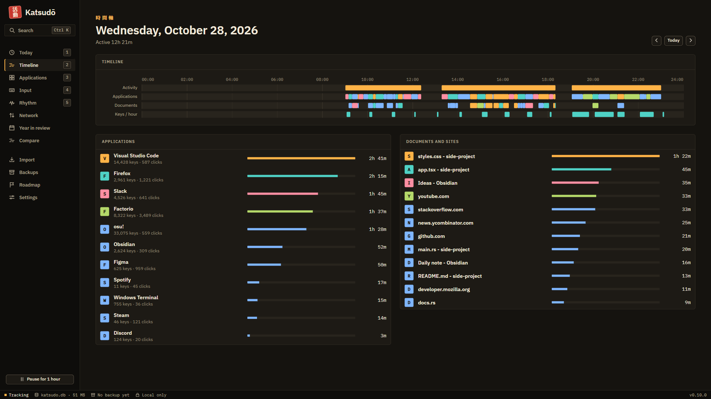 | **Timeline.** Activity, apps, documents and keys per hour for any day, ManicTime style. |
| 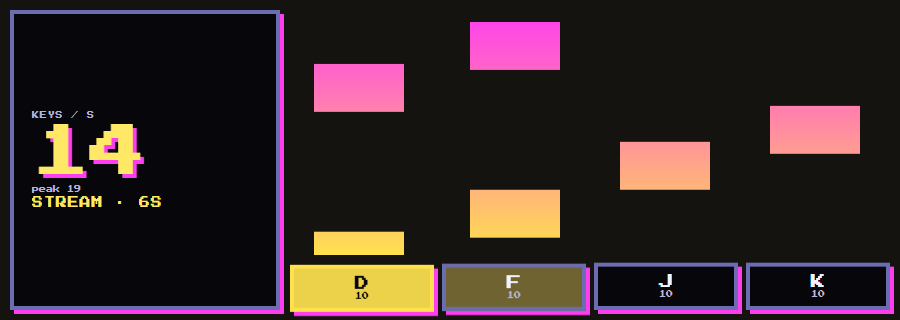 | **Stream overlay for OBS.** Keys per second and a key viewer with rising trails, in any era, from a local page. |

## Sixteen eras (and a Mixtape)

From 1645 to somewhere else. Every era is a full theme with its own type, art, animated welcome and kanji. Switching era plays a piece of the one you pick: a CRT power-off into Phosphor, a pixel dissolve into Arcade, a VHS tracking roll into Synthwave, a Windows 95 window zooming open into Beige Box. Animations are CSS-only, pause when the window is hidden and respect Windows reduced motion; Mixtape picks a different era each day.

| 1977 Phosphor | 1984 Arcade | 1986 Synthwave |
| --- | --- | --- |
| 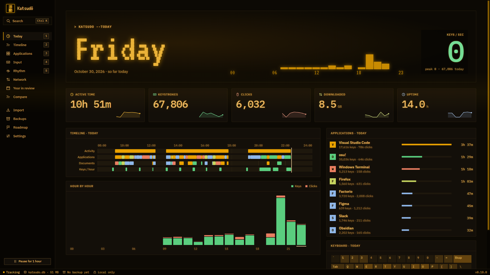 | 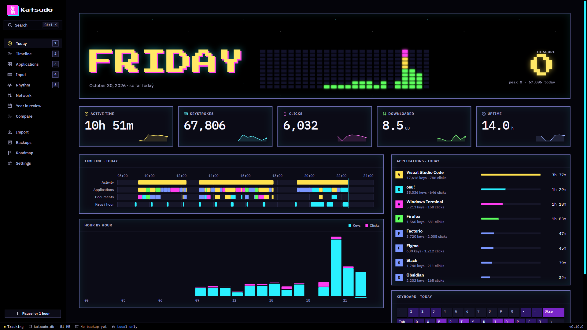 |  |
| **1996 Beige Box** | **Night shift** | **Paper** |
| 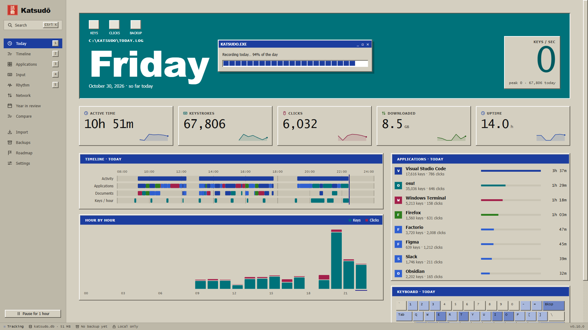 | 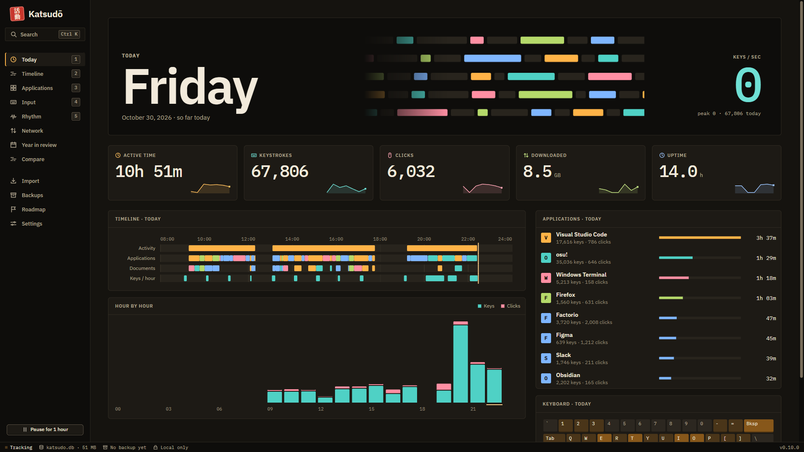 | 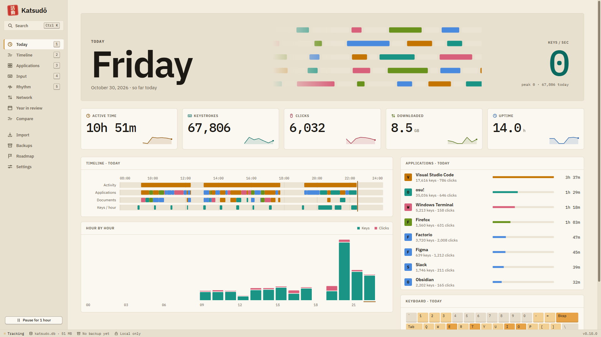 |

**New in 0.16:** 1645 Ronin, 1830 Ukiyo-e, 1889 Steampunk, 1958 Ramen shop, 1995 Anime, 2077 Cyberpunk, 2350 Starship, ???? Signal, and Vapor by day and by night.

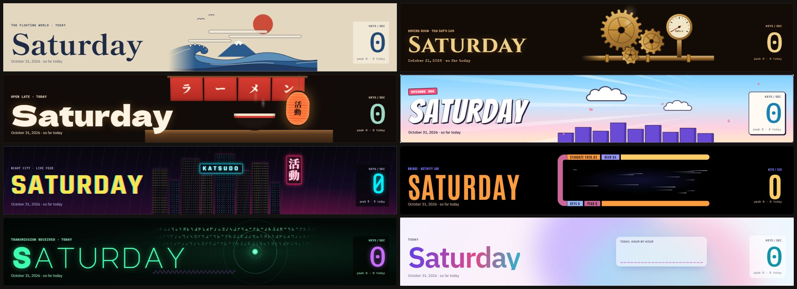

| Welcome: Synthwave | Welcome: Arcade | Welcome: Phosphor |
| --- | --- | --- |
| 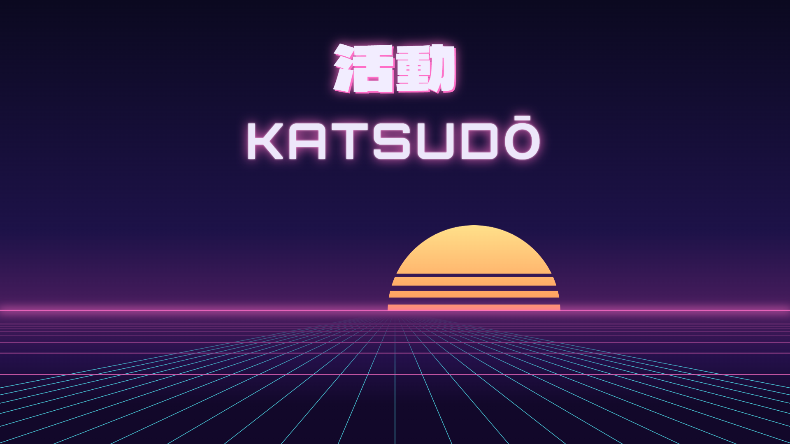 | 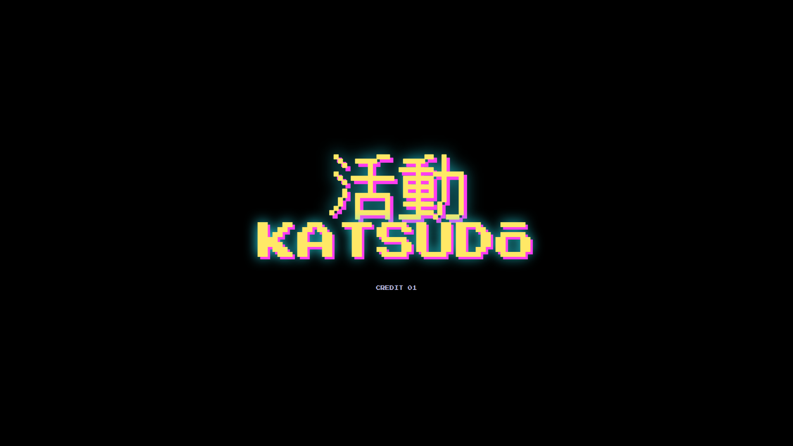 | 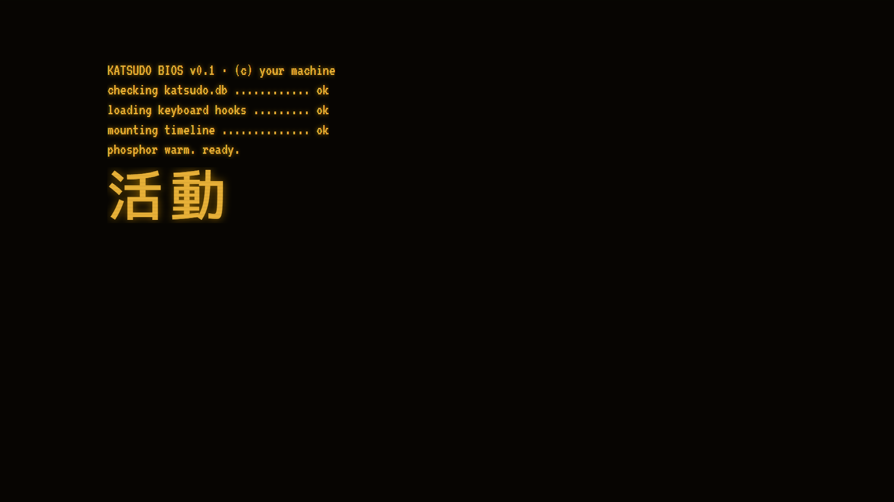 |

The installer is its own little app that picks a random era each time it runs.

## Light by design

Rust and Tauri, using the WebView already built into Windows instead of shipping a browser: about 15 MB to download. In the tray Katsudō uses about 35 MB of memory and around 0.05% CPU, and its keyboard and mouse hooks count each event in about 18 ns. The window's WebView takes a few hundred MB while it's open; a minute after you close it to the tray, Katsudō unloads it completely (and started at sign-in it never loads it until you open the window). Background threads mostly sleep when you're not typing.

## Install

**[Download the latest Katsudo-Setup.exe](https://github.com/invictus-1/katsudo/releases/latest)** (Windows 10 and 11, about 10 MB), or build it yourself (below). It installs per user (no admin prompt), can start with Windows, upgrades in place without losing a count, and uninstalls cleanly (your data stays unless you choose otherwise). It isn't code-signed yet, so SmartScreen will warn the first time (More info → Run anyway).

### Try it with demo data

```bash
python scripts/demo-data.py demo/katsudo.db
```

Then start Katsudō with `KATSUDO_DATA_DIR=demo` and `KATSUDO_DEMO=1`: it shows the made-up history and records nothing.

## Build

Prerequisites: Node 18+, Rust (stable, MSVC) and the Visual Studio C++ build tools. WebView2 ships with Windows 10 and 11.

```bash
npm install
```

```bash
npx tauri dev
```

```bash
npm run setup
```

`npm run setup` builds Katsudō and then the installer around it into `release/`.

Useful switches: `KATSUDO_DATA_DIR=<folder>` runs a separate copy on its own data; `katsudo selftest` checks the input counter under load; `katsudo import <manictime|whatpulse> <source> <katsudo.db>` imports from the command line.

## Roadmap

The plan lives inside the app (Roadmap in the sidebar), where you can star what you want next. Coming up: more eras, meeting and media awareness, merging several PCs, an optional fully-local "ask your history" model, hand and finger balance, ISO layouts, signed releases and an a final polish before 1.0.

## Layout

| Path | What |
| --- | --- |
| `src-tauri/src/` | Rust: tracker, input hooks, SQLite schema and queries, importers, backups, rhythm sessions, overlay server, search and year/compare rollups. |
| `src/` | React UI: views, eras (art, welcomes, styles), live counters. |
| `design/` | The design system: tokens for every era, components. `npm run ds` regenerates `src/ds/`. |
| `installer/` | Katsudō Setup, the era-styled installer and uninstaller. |
| `scripts/` | Design-system sync, kanji font subsetting, demo data. |

## License

[MIT](LICENSE)
